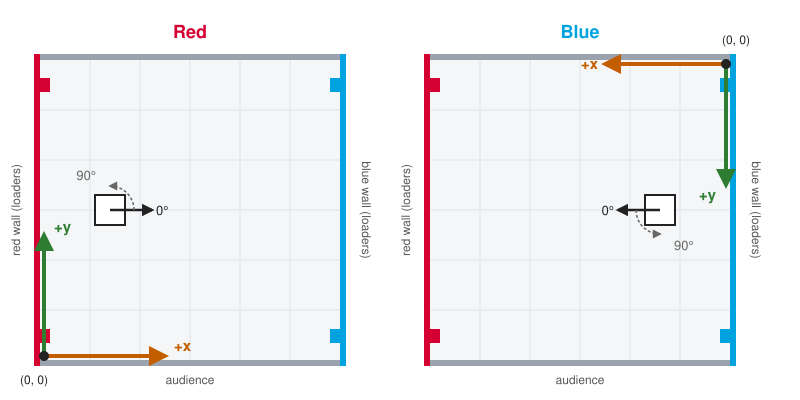

# Field frame

Where x, y and heading point on the field. The frame belongs to your
alliance, not the field: it is the same from either side, so one route runs
from red or blue unchanged.

Standing behind your own wall (the one with your match loaders), facing the
other side:

| | |
|---|---|
| Origin | Inside corner of your wall, on your right |
| +x | Straight ahead, toward the other alliance's wall |
| +y | To your left, along your wall |
| Heading | 0 faces +x, counterclockwise positive, so 90 faces +y |
| Units | Inches and degrees |

On red this is the game manual diagram: origin at the audience end of the
red wall. On blue it is the same frame turned 180 degrees: origin at the far
end of the blue wall.

The Override field is 140.4 in inside, in 23.4 in tiles. A red pose
(x, y, heading) and the blue pose (140.4 - x, 140.4 - y, heading + 180) are
the same spot on the field.

The robot's own frame is +x forward, +y left. Its origin is the point the
pose tracks, the one the tracking wheel offsets in `robot.cpp` are measured
from.

spectaGATR draws its field files in the red frame, so on blue it shows the
robot on the red half.
